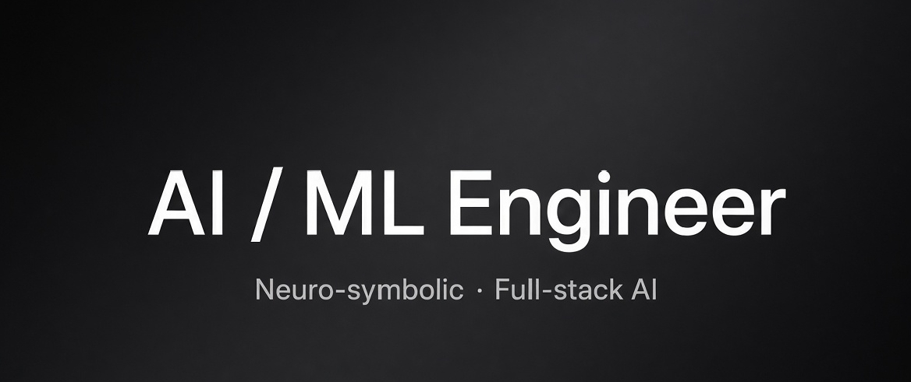

  I've been programming in the TypeScript and Python ecosystem for the past 3 years and most of my work now evolves around ai/ml, full-stack systems & open source softwares, where I train models from scratch, and ship systems people actually use.

---

### Selected Work

- **[pyRPC](https://pyrpc.com)** - Type-safe framework for Python backends ↔ TypeScript frontends
- **[BionicJS](https://bionicjs.vercel.app)** - Experimental full-stack React meta-framework for intelligent web apps
- **[Angelo](https://github.com/Atnatewoss/angelo-ai)** - Decoder-only language model built entirely from scratch
